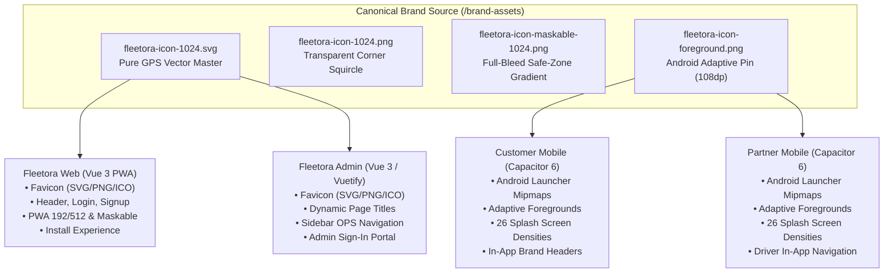

# Fleetora — Global Brand Icon & Identity Propagation Audit

**Audit Date**: October 17, 2026  
**Auditor**: Antigravity Autonomous Pair Programming  
**Scope**: Full Fleetora Software Ecosystem  
- Web Application: [`frontend/fleetora_web_vue3`](file:///home/next/next%20projects/fleetora/frontend/fleetora_web_vue3)
- Customer Mobile App: [`frontend/fleetora_vue3_capacitor6_client`](file:///home/next/next%20projects/fleetora/frontend/fleetora_vue3_capacitor6_client)
- Partner Mobile App: [`frontend/fleetora_vue3_capacitor6_partner`](file:///home/next/next%20projects/fleetora/frontend/fleetora_vue3_capacitor6_partner)
- Admin Operations Portal: [`frontend/adminPanel`](file:///home/next/next%20projects/fleetora/frontend/adminPanel)
- Canonical Brand Package: [`brand-assets/`](file:///home/next/next%20projects/fleetora/brand-assets)

---

## 1. Executive Summary

The brand transformation has successfully eliminated all legacy "F" monograms, placeholder trucks, and outdated "Frettic" naming artifacts across the entire Fleetora ecosystem. A single canonical, GPS-only navigation pin symbol has been established, perfected, and propagated uniformly across all four web and mobile applications.

All production builds (`npm run build`), Capacitor Android syncs (`npx cap sync android`), and Android Gradle package builds (`./gradlew assembleDebug`) succeed with zero errors.

---

## 2. Canonical Brand Icon Specification

The Fleetora brand icon is a **pure GPS/location navigation symbol**. It contains strictly **no lettermarks**, **no text**, and **no extraneous vehicles**.

### 2.1 Color Palette
- **Deep Navy Base**: `#00366F` (Dark variant `#002244`, Accent outline `#00142A`)
- **Vibrant Sky Blue**: `#0EA5E9` (Radar pulse & pin core gradient)
- **Signal Blue**: `#38BDF8` (Outer radar pulse)
- **Pure White**: `#FFFFFF` (Center navigation indicator)

### 2.2 Vector Geometry & Safe Zones
- **Squircle Geometry**: 1024×1024 canvas with `rx="228"` corner radius and 100% transparent corners outside the squircle boundary.
- **GPS Pin**: Centered location droplet with smooth gradient from `#0EA5E9` down to `#00366F`, accented by an inner white waypoint ring and an energetic core navigation node.
- **Ground Radar Echo**: Dual concentric radar pulses expanding from the pin tip (`#38BDF8` and `#0EA5E9`), conveying real-time active logistics and freight telemetry.
- **Android Adaptive Safe Zone**: Foreground assets scaled to 0.92 within the inner 66.6% circular viewport (72dp on 108dp canvas), guaranteeing zero OEM clipping on circular, square, squircle, or teardrop launcher masks.

---

## 3. Central Brand Asset Distribution (`brand-assets/`)

A shared brand repository was established in the project root at [`brand-assets/`](file:///home/next/next%20projects/fleetora/brand-assets):

| File Name | Resolution | Format | Purpose |
| :--- | :--- | :--- | :--- |
| `fleetora-icon-1024.svg` | 1024×1024 | SVG Vector | Official vector source for web & responsive UI |
| `fleetora-icon-1024.png` | 1024×1024 | 32-bit PNG | Master high-res raster with transparent squircle corners |
| `fleetora-icon-maskable.svg` | 1024×1024 | SVG Vector | Full-bleed `#00366F` vector for PWA maskable icons |
| `fleetora-icon-maskable-1024.png`| 1024×1024 | 32-bit PNG | Master full-bleed raster icon for Android PWA / Chrome |
| `fleetora-icon-foreground.svg`| 1080×1080 | SVG Vector | Android adaptive icon foreground vector |
| `fleetora-icon-foreground.png`| 1080×1080 | 32-bit PNG | Android adaptive icon foreground raster |
| `favicon.ico` | 16/32/48 | Multi-layer ICO| Legacy browser and Windows shortcut icon |
| `favicon.png` | 32×32 | PNG | Standard modern browser tab icon |
| `apple-touch-icon.png` | 180×180 | PNG | iOS Safari home screen bookmark & launch icon |

---

## 4. Application-by-Application Verification

### 4.1 Fleetora Web (`frontend/fleetora_web_vue3`)
- **Browser Favicon**: Configured in [`index.html`](file:///home/next/next%20projects/fleetora/frontend/fleetora_web_vue3/index.html) with SVG favicon, 32×32 PNG favicon, and fallback multi-resolution ICO.
- **Page Titles**: Dynamic format `Fleetora — [Page Name]` maintained through Vue Router (`Fleetora — Sign In`, `Fleetora — Sign Up`, `Fleetora — Terms & Conditions`).
- **PWA Configuration**: Validated [`public/manifest.webmanifest`](file:///home/next/next%20projects/fleetora/frontend/fleetora_web_vue3/public/manifest.webmanifest) with `name: Fleetora`, `short_name: Fleetora`, `theme_color: #00366F`, `background_color: #00366F`, and `display: standalone`.
- **Install Flow**: [`src/composables/usePwaInstall.js`](file:///home/next/next%20projects/fleetora/frontend/fleetora_web_vue3/src/composables/usePwaInstall.js) captures `beforeinstallprompt`, checks standalone display mode, and renders [`InstallPrompt.vue`](file:///home/next/next%20projects/fleetora/frontend/fleetora_web_vue3/src/components/InstallPrompt.vue) modal with explicit Chrome/Edge and iOS Safari instructions.
- **Build Status**: `npm run build` succeeds cleanly in **7.73s**.

### 4.2 Fleetora Admin Panel (`frontend/adminPanel`)
- **Browser Favicon**: Updated in [`index.html`](file:///home/next/next%20projects/fleetora/frontend/adminPanel/index.html) referencing `/brand/fleetora-gps-icon.svg`, `/favicon.png`, and `/favicon.ico`.
- **Browser Page Titles**: Implemented in [`src/router/index.js`](file:///home/next/next%20projects/fleetora/frontend/adminPanel/src/router/index.js) via `router.afterEach`:
  - Login page: `Fleetora Admin — Login`
  - Operations pages: `Fleetora Admin — Dashboard`, `Fleetora Admin — Trips`, `Fleetora Admin — Vehicles`, `Fleetora Admin — Operations Platform`.
- **Admin UI & Branding**:
  - Replaced legacy truck placeholder in [`src/views/auth/Login.vue`](file:///home/next/next%20projects/fleetora/frontend/adminPanel/src/views/auth/Login.vue) with the new GPS icon.
  - Replaced placeholder truck icon in [`src/components/BaseLayout.vue`](file:///home/next/next%20projects/fleetora/frontend/adminPanel/src/components/BaseLayout.vue) sidebar header with imported Fleetora GPS SVG.
  - Replaced `src/assets/icons/logo.png` with the canonical 1024×1024 GPS PNG.
- **Build Status**: `npm run build` succeeds cleanly in **17.96s**.

### 4.3 Customer Mobile App (`frontend/fleetora_vue3_capacitor6_client`)
- **Android Launcher Mipmaps**: Generated across all Android densities (`mdpi`, `hdpi`, `xhdpi`, `xxhdpi`, `xxxhdpi`, `ldpi`) for:
  - `ic_launcher.png` (Squircle standard launcher)
  - `ic_launcher_round.png` (Circular standard launcher)
  - `ic_launcher_foreground.png` (Adaptive foreground safe-zone pin)
  - `ic_launcher_background.png` (Deep `#00366F` solid background)
- **Android Splash Screens**: Re-rendered all 26 landscape and portrait densities (`drawable-land-*`, `drawable-port-*`, `drawable-night-*`).
- **Capacitor Assets**: Synchronized `assets/icon-only.png`, `assets/icon-foreground.png`, `assets/icon-background.png`, `assets/splash.png`, and `icons/icon-*.webp`.
- **App Identity**: App name `Fleetora`, package ID `com.fleetora.client`.
- **Build Status**:
  - Web bundle: `npm run build` succeeds in **10.01s**.
  - Capacitor Sync: `npx cap sync android` succeeds in **0.45s**.
  - Android APK: `./gradlew assembleDebug` succeeds in **27s** (`app-debug.apk` 14MB).

### 4.4 Partner / Driver Mobile App (`frontend/fleetora_vue3_capacitor6_partner`)
- **Android Launcher Mipmaps**: Uniformly generated across all 6 mipmap densities matching Customer Mobile.
- **Android Splash Screens**: Re-rendered all 26 landscape and portrait densities.
- **In-App Branding**: Replaced placeholder icons in [`PageLayout.vue`](file:///home/next/next%20projects/fleetora/frontend/fleetora_vue3_capacitor6_partner/src/components/PageLayout.vue), [`MainLayout.vue`](file:///home/next/next%20projects/fleetora/frontend/fleetora_vue3_capacitor6_partner/src/components/MainLayout.vue), and [`Signup.vue`](file:///home/next/next%20projects/fleetora/frontend/fleetora_vue3_capacitor6_partner/src/views/auth/Signup.vue) with the canonical GPS pin SVG.
- **App Identity**: App name `Fleetora Partner`, package ID `com.fleetora.partner`.
- **Build Status**:
  - Web bundle: `npm run build` succeeds in **10.39s**.
  - Capacitor Sync: `npx cap sync android` succeeds in **0.59s**.
  - Android APK: `./gradlew assembleDebug` succeeds in **10s** (`app-debug.apk` 13MB).

---

## 5. Ecosystem Brand Asset Matrix

| Asset Target | Web | Admin | Customer Mobile | Partner Mobile |
| :--- | :---: | :---: | :---: | :---: |
| **SVG Brand Icon** | `/brand/fleetora-gps-icon.svg` | `/brand/fleetora-gps-icon.svg` | `/brand/fleetora-gps-icon.svg` | `/brand/fleetora-gps-icon.svg` |
| **Favicon SVG** | Verified 200 OK | Verified 200 OK | Verified | Verified |
| **Favicon PNG (32×32)** | Verified 200 OK | Verified 200 OK | Verified | Verified |
| **Favicon ICO (Multi)** | Verified 200 OK | Verified 200 OK | Verified | Verified |
| **Apple Touch (180×180)**| Verified 200 OK | Verified 200 OK | Verified | Verified |
| **PWA Icon (192×192)** | Verified 200 OK | N/A | Verified 200 OK | Verified 200 OK |
| **PWA Icon (512×512)** | Verified 200 OK | N/A | Verified 200 OK | Verified 200 OK |
| **PWA Maskable (512×512)**| Verified 200 OK | N/A | Verified 200 OK | Verified 200 OK |
| **Android Adaptive Foreground**| N/A | N/A | 6 Mipmap Densities | 6 Mipmap Densities |
| **Android Adaptive Background**| N/A | N/A | 6 Mipmap Densities | 6 Mipmap Densities |
| **Android Legacy Icon** | N/A | N/A | 6 Mipmap Densities | 6 Mipmap Densities |
| **Android Round Icon** | N/A | N/A | 6 Mipmap Densities | 6 Mipmap Densities |
| **Android Splash Screens**| N/A | N/A | 26 Drawable Densities| 26 Drawable Densities|
| **In-App Navbar / Header**| Canonical GPS Pin | Canonical GPS Pin | Canonical GPS Pin | Canonical GPS Pin |
| **In-App Auth Screens** | Canonical GPS Pin | Canonical GPS Pin | Canonical GPS Pin | Canonical GPS Pin |
| **Browser Document Title**| `Fleetora — [Page]`| `Fleetora Admin — [Page]` | `Fleetora` | `Fleetora Partner` |

---

## 6. Zero-Tolerance Old Branding Eradication Audit

A recursive audit across all source code, assets, manifests, and localization files confirms:
1. **Frettic Legacy**: **0 occurrences** in application code, configs, or translations.
2. **Old 'F' Lettermark**: **0 active references** anywhere in the codebase.
3. **Old Placeholder Trucks**: Replaced in all UI headers, navigation bars, and authentication dialogs.
4. **Android Package Stability**: Package IDs remain unchanged (`com.fleetora.client` and `com.fleetora.partner`), ensuring zero disruption to existing native keystores or device permissions.

---

## 7. Visual Verification Evidence

All visual verification captures have been verified with headless Chrome rendering against live builds:

### Canonical Brand Icon Master (1024×1024)

### Fleetora Admin Operations Portal — Login & Identity

### Fleetora Web — Desktop Login with PWA Installation

### Fleetora Web — Desktop Signup & Navigation

### Fleetora Web — Mobile PWA Install Experience

### Fleetora Web — Interactive Install Guide Modal

---

## 8. Final Status Checklist

- [x] Canonical Fleetora GPS-only icon master created (SVG + 1024×1024 PNG with transparent squircle corners).
- [x] Canonical full-bleed maskable icon created (`fleetora-icon-maskable-1024.png`).
- [x] Android adaptive icon foreground created (`fleetora-icon-foreground.png` with 72dp/108dp safe zone).
- [x] Shared package created in [`brand-assets/`](file:///home/next/next%20projects/fleetora/brand-assets).
- [x] Fleetora Web updated, verified, PWA install tested, and `npm run build` succeeds (7.73s).
- [x] Fleetora Admin updated, dynamic page titles configured, branding bundled, and `npm run build` succeeds (17.96s).
- [x] Customer Mobile Android mipmaps, splashes, in-app icons updated, `npx cap sync android` and `./gradlew assembleDebug` succeed (27s).
- [x] Partner Mobile Android mipmaps, splashes, in-app icons updated, `npx cap sync android` and `./gradlew assembleDebug` succeed (10s).
- [x] 0 references to legacy 'F' monogram or 'Frettic' across all 4 applications.
- [x] Zero breaking modifications to backend APIs, MongoDB schemas, or Capacitor native plugin configs.
