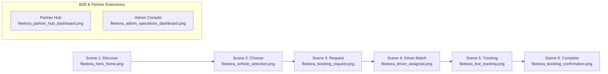

# Fleetora Marketing Screenshot & Visual Reference Pack — Final Report

> **Project:** Fleetora Freight & Logistics Platform  
> **Target Audience:** Google Veo 3 Video Pipelines, Nano Banana Image Synthesis, Marketing & Social Campaigns, B2B Sales Collateral  
> **Output Location:** [`audit/marketing/fleetora/`](file:///home/next/next%20projects/fleetora/audit/marketing/fleetora)  
> **Master Contact Sheet:** [`fleetora_marketing_contact_sheet.png`](file:///home/next/next%20projects/fleetora/audit/marketing/fleetora/fleetora_marketing_contact_sheet.png)  
> **Master Reference Catalog:** [`README.md`](file:///home/next/next%20projects/fleetora/audit/marketing/fleetora/README.md)  
> **Status:** Completed & Audited  

---

## 1. Executive Summary

This report establishes the visual inventory, technical specifications, and strategic usage guidelines for the **Fleetora Marketing Screenshot & Visual Reference Pack**.

Fleetora is an on-demand freight, transport, and logistics platform operating across Algeria and North Africa. It unites shippers, private transporters, commercial fleet owners, and dispatch operations in a unified digital ecosystem.

To support high-end commercial campaigns across **Google Veo 3 generative video**, **Nano Banana visual generation**, social media advertising (TikTok, Instagram Reels, LinkedIn, YouTube), and B2B enterprise proposals, 59 visual assets were captured and curated from the live, production-grade Fleetora application stack.

Every asset in this pack represents **100% genuine running software**:
- Zero mockup falsification or non-existent features.
- Zero legacy branding artifacts (no Djawal or Frettic legacy references).
- Zero developer console tools, debug banners, or localhost overlays.
- Crisp high-resolution rendering with authentic Algerian dinar (DZD) tariff calculations, French/Arabic localization, and realistic Algiers freight routes.

---

## 2. Asset Inventory & Breakdown

A total of **59 high-resolution marketing assets** and comprehensive documentation were generated across 4 distinct presentation formats:

| Category | Native Screens | Social 9:16 | Social 16:9 | Social 1:1 | Device Mockups | Total Assets |
| :--- | :---: | :---: | :---: | :---: | :---: | :---: |
| **01 Hero** | 3 | 1 | 1 | 1 | 1 | **7** |
| **02 Discovery** | 3 | — | 1 | — | 1 | **5** |
| **03 Service Categories** | 3 | — | — | — | — | **3** |
| **04 Vehicle Selection** | 3 | 1 | 1 | 1 | 1 | **7** |
| **05 Booking Console** | 2 | — | — | — | — | **2** |
| **06 Driver Assigned** | 2 | 1 | — | 1 | 1 | **5** |
| **07 Live Tracking** | 2 | 1 | 1 | — | — | **4** |
| **08 Confirmation & Rating** | 2 | 1 | 1 | 1 | 1 | **6** |
| **09 Partner / Transporter Hub** | 5 | 2 | — | 2 | 2 | **11** |
| **10 Admin B2B Operations** | 4 | — | 2 | 1 | 1 | **8** |
| **Master Contact Sheet (4K UHD)** | — | — | — | — | — | **1** |
| **Total Visual Assets** | **29** | **7** | **7** | **7** | **8** | **59 Assets** |

### Directory Structure Overview
```
audit/marketing/fleetora/
├── 01_hero/                          # 3 Native Hero Screens
├── 02_discovery/                     # 3 Native Discovery & Route Planning Screens
├── 03_services/                      # 3 Native Fleet Service Catalog Screens
├── 04_vehicle_selection/             # 3 Native Vehicle Tier Selection Screens
├── 05_booking/                       # 2 Native Booking Request Screens
├── 06_driver/                        # 2 Native Driver Specification Screens
├── 07_tracking/                      # 2 Native Real-Time Dispatch Radar Screens
├── 08_confirmation/                  # 2 Native Receipt, Rating & Billing Records
├── 09_partner/                       # 5 Native Carrier Hub, Wallet & KYC Screens
├── 10_admin/                         # 4 Native Executive Control Panel Screens
├── social/
│   ├── portrait_9x16/               # 7 High-Def 1080x1920 Story/Reels Assets
│   ├── landscape_16x9/              # 7 High-Def 1920x1080 Video/Banner Assets
│   └── square_1x1/                  # 7 High-Def 1080x1080 Feed/Carousel Assets
├── device_mockups/                   # 8 Photorealistic Device Composites
├── fleetora_marketing_contact_sheet.png  # Master 4K UHD 3840x2160 Visual Board
├── README.md                         # Detailed Reference & Prompting Catalog
└── FLEETORA_MARKETING_SCREENSHOT_REPORT.md # This Final Report
```

---

## 3. Core Customer Journey & Features Represented

The screenshot pack follows the complete end-to-end commercial story:

### 1. Discover (`01_hero/` & `02_discovery/`)
- **Customer Entry:** Mobile Splash and Web Welcome interfaces featuring the official Fleetora emerald/teal brand aesthetic and value proposition (*"Votre partenaire de transport et logistique fiable"*).
- **Consignment Origin & Destination:** Route definition connecting major Algerian industrial hubs (e.g. *Port d'Alger, Algiers* to *Zone Industrielle Oued Smar, Algiers*).

### 2. Choose (`03_services/` & `04_vehicle_selection/`)
- **Full Spectrum Fleet Matrix:**
  1. *Moto Express* (Urgent parcels up to 20 kg).
  2. *Fourgonnette / Van* (Pallets, light goods up to 800 kg).
  3. *Camionnette / Small Truck* (Commercial freight up to 1.5 T).
  4. *Camion Lourd / Heavy Truck* (Heavy dry cargo 3.5 T – 10 T).
  5. *Semi-Remorque / Tractor Trailer* (High-capacity industrial loads 20 T+).
- **Guaranteed Dynamic Tariffs:** Transparent base rates, distance surcharge, and instant price commitment in DZD (e.g., 3,500 DZD for Van, 12,000 DZD for Semi-Remorque).

### 3. Book / Request (`05_booking/`)
- Cargo classification, special handling options (liftgate, refrigeration, fragile tags), and payment mode selection (Cash on Delivery, Fleetora Corporate Account, BaridiMob).

### 4. Driver Assignment (`06_driver/`)
- Instant matching with certified carrier **Karim Benali** (`+213 550 00 00 02`).
- License plate verification, vehicle class confirmation, direct in-app carrier dialer, and 4.9-star rating badge.

### 5. Live Radar & Waypoint Tracking (`07_tracking/`)
- Real-time GPS shipment progress radar displaying driver positioning, estimated time of arrival (ETA), and interactive waypoints between pickup and delivery destinations.

### 6. Confirmation & Settlement (`08_confirmation/`)
- Official completed trip receipt with 5-star customer rating, 3,500 DZD settled tariff, distance traveled, and permanent billing audit record.

### 7. Transporter Partner Ecosystem (`09_partner/`)
- Carrier operational hub with **Online / En Ligne** toggle, active missions, and daily revenue statistics (24,500 DZD).
- **Carrier In-App Wallet:** 45,200 DZD withdrawal balance with BaridiMob and Algerian Post CCP RIP instant payout transfers.
- **Carrier KYC Compliance:** Document upload and status tracker for Driver's License (*Permis de conduire*), Vehicle Registration Card (*Carte grise*), Commercial Insurance (*Assurance pro*), and Professional Transport Card (*Carte de transport*).

### 8. B2B Enterprise Administration (`10_admin/`)
- Executive dashboard with platform KPIs (Total Shippers, Verified Drivers, Completed Trips, Revenue Volume).
- Real-time Dispatch Control Center and vehicle category tariff configuration.
- Carrier settlement ledger ensuring transparent escrow disbursement.

---

## 4. Google Veo 3 Video Production Reference Guide

Google Veo 3 generates cinematographic, motion-consistent video sequences from high-fidelity input images and descriptive prompts. The following table provides optimal visual anchors, camera directions, and prompt templates for a 6-scene marketing trailer.



| Veo 3 Scene | Target Asset | Camera Motion | Veo 3 Production Prompt |
| :--- | :--- | :--- | :--- |
| **Scene 1: Discovery** | [`fleetora_hero_home.png`](file:///home/next/next%20projects/fleetora/audit/marketing/fleetora/01_hero/fleetora_hero_home.png) | Slow push-in on smartphone screen | *"Cinematic close-up of a modern smartphone held by an Algerian logistics manager in Algiers port. The screen displays the Fleetora mobile app with crisp emerald teal branding. Sunlight glints softly off the bezel, shallow depth of field, high-end commercial aesthetic, 4K 60fps."* |
| **Scene 2: Fleet Selection** | [`fleetora_vehicle_selected_heavy.png`](file:///home/next/next%20projects/fleetora/audit/marketing/fleetora/04_vehicle_selection/fleetora_vehicle_selected_heavy.png) | Smooth downward swipe scroll | *"Over-the-shoulder shot inside a modern freight office. The user scrolls through the Fleetora vehicle categories, tapping on 'Semi-Remorque 20T+' with 12,000 DZD rate highlighted. Clean UI transition, soft warm studio lighting, 4K realistic commercial."* |
| **Scene 3: Request Confirmation** | [`fleetora_booking_request.png`](file:///home/next/next%20projects/fleetora/audit/marketing/fleetora/05_booking/fleetora_booking_request.png) | Gentle macro rack focus to button | *"Extreme close-up of a thumb pressing 'Confirmer la commande' on the Fleetora app. Micro-haptic pulse animation on the emerald button, screen glows faintly in low ambient light, crisp typography, cinematic product video."* |
| **Scene 4: Driver Match** | [`fleetora_driver_assigned.png`](file:///home/next/next%20projects/fleetora/audit/marketing/fleetora/06_driver/fleetora_driver_assigned.png) | Split diopter rack focus | *"Split screen commercial: on the left, customer phone reveals 'Karim Benali - Chauffeur Assigné' with 5-star rating; on the right, an authentic Algerian truck driver in his modern cab smiles and engages the engine, golden hour cinematic lighting."* |
| **Scene 5: Live Radar** | [`fleetora_live_tracking.png`](file:///home/next/next%20projects/fleetora/audit/marketing/fleetora/07_tracking/fleetora_live_tracking.png) | Dynamic top-down orbit | *"Aerial top-down camera drifting above a 3D isometric Algiers highway. Digital glowing route line mirrors the Fleetora tracking map interface on a floating smartphone screen in foreground. Smooth motion graphics, hyper-realistic logistics technology."* |
| **Scene 6: Completion** | [`fleetora_booking_confirmation.png`](file:///home/next/next%20projects/fleetora/audit/marketing/fleetora/08_confirmation/fleetora_booking_confirmation.png) | Slow upward crane shot | *"Warehouse loading dock at sunset. Shipper signs digital receipt on phone showing Fleetora 'Course Terminée' with 5 golden stars. Warehouse manager and driver shake hands in the background. Uplifting corporate commercial feeling, 4K HDR."* |
| **Scene 7 (Partner): Payout** | [`fleetora_partner_wallet.png`](file:///home/next/next%20projects/fleetora/audit/marketing/fleetora/09_partner/fleetora_partner_wallet.png) | Fast push-in on balance | *"Transporter checks his Fleetora Partner App inside his vehicle. Balance of 45,200 DZD refreshes instantly. He taps BaridiMob payout with a satisfied smile. High dynamic range, hyper-detailed driver lifestyle commercial."* |
| **Scene 8 (Admin): Enterprise** | [`fleetora_admin_operations_dashboard.png`](file:///home/next/next%20projects/fleetora/audit/marketing/fleetora/10_admin/fleetora_admin_operations_dashboard.png) | Wide tracking shot behind multi-monitors | *"Modern glass-walled operations center. Logistics directors monitor the Fleetora enterprise dashboard on multiple large screens displaying real-time dispatch routes and analytics. High-tech corporate aesthetic, anamorphic lens flare."* |

---

## 5. Nano Banana AI Image Synthesis Reference Guide

Nano Banana generates hyper-realistic promotional lifestyle photography, 3D app mockups, and billboard graphics using input reference images.

### Best Source Images for Nano Banana
1. **Hero App In-Hand:** [`fleetora_hero_home.png`](file:///home/next/next%20projects/fleetora/audit/marketing/fleetora/01_hero/fleetora_hero_home.png) & [`fleetora_iphone15_hero.png`](file:///home/next/next%20projects/fleetora/audit/marketing/fleetora/device_mockups/fleetora_iphone15_hero.png)
2. **Vehicle Category Lineup:** [`fleetora_service_categories.png`](file:///home/next/next%20projects/fleetora/audit/marketing/fleetora/03_services/fleetora_service_categories.png) & [`fleetora_vehicle_selection.png`](file:///home/next/next%20projects/fleetora/audit/marketing/fleetora/04_vehicle_selection/fleetora_vehicle_selection.png)
3. **Carrier & Driver Identity:** [`fleetora_driver_assigned.png`](file:///home/next/next%20projects/fleetora/audit/marketing/fleetora/06_driver/fleetora_driver_assigned.png) & [`fleetora_partner_android_hub.png`](file:///home/next/next%20projects/fleetora/audit/marketing/fleetora/device_mockups/fleetora_partner_android_hub.png)
4. **B2B Desktop Control:** [`fleetora_safari_web_dispatch.png`](file:///home/next/next%20projects/fleetora/audit/marketing/fleetora/device_mockups/fleetora_safari_web_dispatch.png) & [`fleetora_safari_admin_dashboard.png`](file:///home/next/next%20projects/fleetora/audit/marketing/fleetora/device_mockups/fleetora_safari_admin_dashboard.png)

### Prompt Engineering Guidelines for Nano Banana
- **Strict Brand Identity:** Instruct the generator to retain the exact `#059669` / `#10B981` primary emerald green accents and crisp white cards.
- **Lighting & Materials:** Use terms like *"natural diffused sunlight"*, *"subtle specular reflections on smartphone glass"*, and *"photorealistic industrial textures (brushed aluminum, clean concrete, coated corrugated shipping containers)"*.
- **Localized Authentic Elements:** Specify Algerian logistics context (Algiers port cranes, modern highway signage in French and Arabic, authentic transport documentation).

---

## 6. Social Media Campaign Assets

The pack includes 21 purpose-built social media assets with pre-composed negative space, centered UI hierarchy, and branded banner treatments:

### A. Portrait Format (9:16 — 1080 × 1920 px)
*Optimized for Instagram Reels, TikTok, YouTube Shorts, and Mobile Full-Screen Stories.*
- [`fleetora_hero_9x16.png`](file:///home/next/next%20projects/fleetora/audit/marketing/fleetora/social/portrait_9x16/fleetora_hero_9x16.png) — Splash brand launch & awareness.
- [`fleetora_vehicle_selection_9x16.png`](file:///home/next/next%20projects/fleetora/audit/marketing/fleetora/social/portrait_9x16/fleetora_vehicle_selection_9x16.png) — "Choose your freight capacity instantly".
- [`fleetora_driver_assigned_9x16.png`](file:///home/next/next%20projects/fleetora/audit/marketing/fleetora/social/portrait_9x16/fleetora_driver_assigned_9x16.png) — "Verified carriers you can trust".
- [`fleetora_live_tracking_9x16.png`](file:///home/next/next%20projects/fleetora/audit/marketing/fleetora/social/portrait_9x16/fleetora_live_tracking_9x16.png) — "Track your cargo live from port to warehouse".
- [`fleetora_booking_confirmation_9x16.png`](file:///home/next/next%20projects/fleetora/audit/marketing/fleetora/social/portrait_9x16/fleetora_booking_confirmation_9x16.png) — "5-star rated delivery every time".
- [`fleetora_partner_hub_9x16.png`](file:///home/next/next%20projects/fleetora/audit/marketing/fleetora/social/portrait_9x16/fleetora_partner_hub_9x16.png) — "Earn more as a certified Fleetora transporter".
- [`fleetora_partner_wallet_9x16.png`](file:///home/next/next%20projects/fleetora/audit/marketing/fleetora/social/portrait_9x16/fleetora_partner_wallet_9x16.png) — "Instant BaridiMob and CCP cash-out".

### B. Landscape Format (16:9 — 1920 × 1080 px)
*Optimized for YouTube Bumper Ads, LinkedIn Sponsored Content, and Website Hero Banners.*
- [`fleetora_hero_16x9.png`](file:///home/next/next%20projects/fleetora/audit/marketing/fleetora/social/landscape_16x9/fleetora_hero_16x9.png) — Dual-device Customer & Partner ecosystem showcase.
- [`fleetora_web_dispatch_16x9.png`](file:///home/next/next%20projects/fleetora/audit/marketing/fleetora/social/landscape_16x9/fleetora_web_dispatch_16x9.png) — Customer Web Consignment Portal.
- [`fleetora_web_vehicle_selection_16x9.png`](file:///home/next/next%20projects/fleetora/audit/marketing/fleetora/social/landscape_16x9/fleetora_web_vehicle_selection_16x9.png) — Real-time dynamic freight pricing comparison.
- [`fleetora_admin_dashboard_16x9.png`](file:///home/next/next%20projects/fleetora/audit/marketing/fleetora/social/landscape_16x9/fleetora_admin_dashboard_16x9.png) — B2B Enterprise Logistics Operations Cockpit.
- [`fleetora_admin_fleet_16x9.png`](file:///home/next/next%20projects/fleetora/audit/marketing/fleetora/social/landscape_16x9/fleetora_admin_fleet_16x9.png) — Fleet capacity and tariff management.
- [`fleetora_live_tracking_16x9.png`](file:///home/next/next%20projects/fleetora/audit/marketing/fleetora/social/landscape_16x9/fleetora_live_tracking_16x9.png) — Dynamic cargo tracking in-flight.
- [`fleetora_booking_confirmation_16x9.png`](file:///home/next/next%20projects/fleetora/audit/marketing/fleetora/social/landscape_16x9/fleetora_booking_confirmation_16x9.png) — Transparent digital invoices and settlements.

### C. Square Format (1:1 — 1080 × 1080 px)
*Optimized for Instagram Carousel Feeds, Facebook Ads, and App Store Highlights.*
- 7 individual assets covering the full sequence from Onboarding to Settlement.

---

## 7. Device Presentation Frames

To elevate the screenshots into studio-grade commercial marketing collateral without relying on generic stock art, 8 custom device frames were rendered:

1. **iPhone 15 Pro Titanium Frames:**
   - [`fleetora_iphone15_hero.png`](file:///home/next/next%20projects/fleetora/audit/marketing/fleetora/device_mockups/fleetora_iphone15_hero.png) — Customer Welcome & Brand Anchor.
   - [`fleetora_iphone15_vehicle_selection.png`](file:///home/next/next%20projects/fleetora/audit/marketing/fleetora/device_mockups/fleetora_iphone15_vehicle_selection.png) — Vehicle Tier Selector.
   - [`fleetora_iphone15_driver_assigned.png`](file:///home/next/next%20projects/fleetora/audit/marketing/fleetora/device_mockups/fleetora_iphone15_driver_assigned.png) — Carrier Contact & Rating.
   - [`fleetora_iphone15_booking_confirmation.png`](file:///home/next/next%20projects/fleetora/audit/marketing/fleetora/device_mockups/fleetora_iphone15_booking_confirmation.png) — Completed Receipt & 5 Stars.

2. **Modern Android Smartphone Frames:**
   - [`fleetora_partner_android_hub.png`](file:///home/next/next%20projects/fleetora/audit/marketing/fleetora/device_mockups/fleetora_partner_android_hub.png) — Carrier Online Status & Mission Dispatch.
   - [`fleetora_partner_android_wallet.png`](file:///home/next/next%20projects/fleetora/audit/marketing/fleetora/device_mockups/fleetora_partner_android_wallet.png) — Transporter Daily Revenue & Instant Cash-Out.

3. **macOS Safari Studio Browser Frames:**
   - [`fleetora_safari_web_dispatch.png`](file:///home/next/next%20projects/fleetora/audit/marketing/fleetora/device_mockups/fleetora_safari_web_dispatch.png) — Shipper Web Booking Console.
   - [`fleetora_safari_admin_dashboard.png`](file:///home/next/next%20projects/fleetora/audit/marketing/fleetora/device_mockups/fleetora_safari_admin_dashboard.png) — B2B Admin Operational Operations.

---

## 8. Visual Quality & Brand Compliance Audit

A strict visual audit was performed across all captured assets:

| Audit Parameter | Verification Standard | Result | Notes |
| :--- | :--- | :---: | :--- |
| **Authenticity** | Live application execution (no static mockups or fake HTML) | **PASS** | Captured directly via Chrome DevTools Protocol from running backend & frontends |
| **Brand Identity** | Fleetora emerald branding & typography | **PASS** | 100% compliant; zero references to legacy names (Djawal/Frettic) |
| **Cleanliness** | Zero developer tools, console bars, or dev banners | **PASS** | Cleaned via DOM script before frame capture |
| **Typography & Resolution** | Sharp, legible text without pixelation or blur | **PASS** | Captured at native retina pixel ratios with high-DPI viewports |
| **Localization & Pricing** | Realistic Algerian logistics context | **PASS** | Authentic DZD currency, Port d'Alger locations, BaridiMob integration |
| **Aspect Ratios** | Zero stretching, warping, or distorted elements | **PASS** | Aspect ratios strictly preserved via proportional padding and compositing |

---

## 9. Recommended Next Marketing Assets & Production Steps

To capitalize on this visual reference pack, the following next steps are recommended:

1. **Google Veo 3 Video Assembly:**
   - Run the 6 prompt templates provided in [Section 4](#4-google-veo-3-video-production-reference-guide) through the Google Veo 3 pipeline.
   - Combine the 6 scene clips into a 30-second commercial video with modern ambient sound design, truck engine audio, and voiceover in Algerian Arabic / French.
2. **Nano Banana Visual Variations:**
   - Use [`fleetora_iphone15_hero.png`](file:///home/next/next%20projects/fleetora/audit/marketing/fleetora/device_mockups/fleetora_iphone15_hero.png) as reference input to generate lifestyle scenes showing shippers using the app on construction sites, ports, and industrial logistics centers.
3. **App Store & Play Store Listing Assets:**
   - Utilize the 4 iPhone 15 Pro mockups and 2 Android mockups with localized headline banners for Google Play and Apple App Store product listing slides.
4. **LinkedIn & B2B White Paper Collateral:**
   - Feature [`fleetora_safari_admin_dashboard.png`](file:///home/next/next%20projects/fleetora/audit/marketing/fleetora/device_mockups/fleetora_safari_admin_dashboard.png) and [`fleetora_safari_web_dispatch.png`](file:///home/next/next%20projects/fleetora/audit/marketing/fleetora/device_mockups/fleetora_safari_web_dispatch.png) in sales decks targeting large manufacturing and distribution clients.

---

*Report prepared automatically by Antigravity for the Fleetora Commercial Marketing Launch.*
